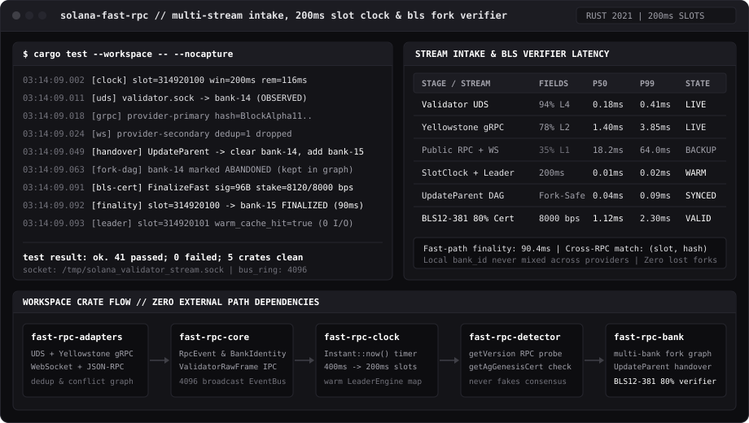

# solana-fast-rpc


fast multi-RPC stream combiner, 200ms slot clock, and fork-safe BLS certificate checker for Solana in pure Rust.

wrote this at 3am with cold adrak chai because one public RPC was 4 slots behind and the other was lying about forks.



## what this does

- **reads multiple streams together**: takes local validator UDS socket (`/tmp/solana_validator_stream.sock`), Yellowstone gRPC, WebSocket, and standard JSON-RPC and turns them into one clean `RpcEvent` stream.
- **never mixes up node-local `bank_id`**: `bank_id=7` on RPC A is NOT `bank_id=7` on RPC B. we match across providers using `(slot, blockhash)` only.
- **200ms hardware slot timer**: uses `std::time::Instant` instead of wall clock so NTP jumps never break your slot countdown.
- **zero-network leader lookup**: keeps upcoming slot leaders warm in RAM (`BTreeMap`) so checking the next leader takes nanoseconds, not an HTTP call.
- **keeps dead forks for debugging**: when fast leader handover (`UpdateParent`) drops a bank and makes a new one, we mark the old bank `Abandoned` instead of deleting it like nothing happened.
- **checks real BLS12-381 certs**: verifies 96-byte BLS signatures and integer stake basis points (`8000 bps` = 80% fast path) with zero float rounding bugs.
- **honest about missing data**: if a free public RPC does not send `bank_id` or `block_footer`, we mark it unavailable instead of making up fake numbers. not a bug bhai, honest code feature.

## copy and run in 60 sec

- clone the repo and jump in:

```bash
git clone https://github.com/LevCodeLab/solana-fast-rpc.git
cd solana-fast-rpc
```

- check all 5 crates compile clean:

```bash
cargo check --workspace --all-targets
```

- run the full test suite (slot timer, fork handover, multi-RPC conflict check, real BLS12-381 signature tamper tests):

```bash
cargo test --workspace
```

- quick code taste if you want to wire it into your own bot or indexer:

```rust
use fast_rpc_clock::{LeaderEngine, SlotClock};
use fast_rpc_core::types::{LeaderId, Slot, SlotDuration};

let mut clock = SlotClock::new(SlotDuration::MS_200);
clock.on_slot_observed(Slot(314_920_100));

let mut leaders = LeaderEngine::new();
leaders.set_leader(Slot(314_920_100), LeaderId::new("ValidatorAlpha"));
println!("slot progress: {:.0}%", clock.progress().progress * 100.0);
```

## where to edit code

when i wrote some of these trait bounds at 4am only me and bhagwan knew why borrowck was happy, now only bhagwan knows, so here is the cheat sheet of where everything lives:

- `crates/fast-rpc-core/src/types.rs`: all core structs (`Slot`, `Blockhash`, `BankId`, `SlotDuration`, `SyntheticCandidateId`).
- `crates/fast-rpc-core/src/ipc_wire.rs`: `ValidatorRawFrame` and `GeyserPayload` JSONL wire format for local validator UDS sockets.
- `crates/fast-rpc-core/src/bus.rs`: lock-free `tokio::sync::broadcast` ring buffer (`EventBus`) so slow readers never block fast streams.
- `crates/fast-rpc-clock/src/clock.rs`: 200ms/250ms/400ms slot progress timer (`SlotClock`).
- `crates/fast-rpc-clock/src/leader.rs`: warm in-memory leader schedule cache (`LeaderEngine`).
- `crates/fast-rpc-detector/src/detector.rs`: probes `getVersion` and `getAgGenesisCert` to see what the cluster actually supports.
- `crates/fast-rpc-bank/src/graph.rs`: `BankGraph` DAG that stores candidate, canonical, abandoned, and finalized banks per slot.
- `crates/fast-rpc-bank/src/update_parent.rs`: handles mid-slot `UpdateParent` leader handovers without losing fork history.
- `crates/fast-rpc-bank/src/certificate.rs`: `CertificateEngine` for `solana-bls-signatures` pairing checks and 80% / 60% stake math.
- `crates/fast-rpc-adapters/src/yellowstone_adapter.rs`: Yellowstone gRPC client (`FAST_RPC_YELLOWSTONE_ENDPOINT`).
- `crates/fast-rpc-adapters/src/geyser_uds_adapter.rs`: Unix Domain Socket listener for local validator streams.
- `crates/fast-rpc-adapters/src/evidence_graph.rs`: compares fields across multiple RPCs and flags conflicts cleanly.

## env vars (optional)

- `FAST_RPC_YELLOWSTONE_ENDPOINT`: gRPC URL (defaults to `https://solana-testnet.publicnode.com:443`).
- `FAST_RPC_YELLOWSTONE_TOKEN`: optional `x-token` auth string if your gRPC node asks for one.

## license

MIT License. Copyright (c) 2026 LevCodeLab. do whatever you want bhai, just dont blame me if public RPC rate-limits you at 2am.
// SIMD acceleration routines
